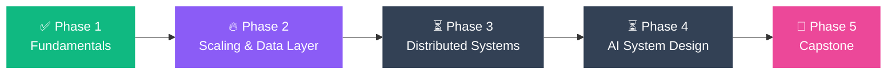

<div align="center">


<a href="https://git.io/typing-svg"></a>

<br/><br/>


<a href="https://anu-portfolio-ashen.vercel.app/"></a>
<a href="https://www.linkedin.com/in/anupriya-ranjan-956580384/"></a>
<a href="mailto:anu89ranjan89@gmail.com"></a>

</div>

<br/>

## 👩‍💻 About Me

```bash
$ whoami
Anupriya Kumari Ranjan — AI Engineer & Full Stack Developer (MCA, IET Lucknow)

$ ls ./building
RecruitGPT/   SheSync-AI/   MoneyMind-AI/   CodeCanvas/

$ cat stack.txt
Python · FastAPI · Next.js · LangGraph · pgvector · AWS

$ ./learning --now
▸ system_design  [ phase 2 / 5 ]  scaling & data layer
```

---

## ⚡ What I Do

<table>
<tr>
<td width="33%" valign="top" align="center">

### 🧠 AI Engineering
Hybrid retrieval (**FAISS + pgvector + BM25 + reranking**), RAG pipelines, explainable ML and **multi-agent systems** with LangGraph.

</td>
<td width="33%" valign="top" align="center">

### 🌐 Full Stack
End-to-end products: **FastAPI** backends, **Next.js / React** frontends, PostgreSQL, Docker, shipped on **AWS**.

</td>
<td width="33%" valign="top" align="center">

### 🏗️ System Design
Learning to make AI apps **scale**: caching, queues, sharding and distributed design. Progress is tracked below.

</td>
</tr>
</table>

---

## 🧰 Tech Stack

<div align="center">


<br/>


<br/>


<br/>


</div>

---

## 🚀 Featured Projects

<table>
<tr>
<td width="50%" align="center" valign="top">

<sub>PCOS risk prediction with Explainable AI + multi-domain RAG (LangChain, FAISS, BGE embeddings) and downloadable PDF reports. Deployed on AWS Amplify, EC2, RDS and API Gateway.</sub>
<br/><sub><code>RAG</code> <code>FastAPI</code> <code>Next.js</code> <code>PostgreSQL</code> <code>AWS</code></sub>
<br/><br/>
<a href="https://github.com/anu89ranjan89/SheSync-AI"></a>
<a href="https://main.d11i2xaejtpqa8.amplifyapp.com/"></a>
</td>
<td width="50%" align="center" valign="top">

<sub>LangGraph agents for resume intelligence, JD analysis, candidate ranking, interview evaluation and recruiter assistance, backed by PostgreSQL + pgvector.</sub>
<br/><sub><code>LangGraph</code> <code>pgvector</code> <code>FastAPI</code> <code>Next.js</code></sub>
<br/><br/>

</td>
</tr>
<tr>
<td width="50%" align="center" valign="top">
<br/>

<sub>Extracts data from bank statements and payment screenshots with Gemini Vision, plus Groq-powered coaching, budgets and interactive dashboards. Built during the PanScience Innovations Fellowship.</sub>
<br/><sub><code>React</code> <code>FastAPI</code> <code>Gemini Vision</code> <code>Groq</code></sub>
<br/><br/>
<a href="https://github.com/anu89ranjan89/MoneyMind-AI"></a>
<a href="https://www.linkedin.com/feed/update/urn:li:activity:7471559147637997568/"></a>
</td>
<td width="50%" align="center" valign="top">
<br/>

<sub>Multi-language online editor with live preview, auto-save and a Groq assistant inside Monaco that explains, debugs and inserts code.</sub>
<br/><sub><code>React</code> <code>Monaco</code> <code>Groq</code> <code>REST APIs</code></sub>
<br/><br/>
<a href="https://github.com/anu89ranjan89/CodeCanvas"></a>
<a href="https://www.linkedin.com/feed/update/urn:li:activity:7461518346258399232/"></a>
</td>
</tr>
</table>

<details>
<summary><b>🏆 Hackathon builds</b></summary>

<br/>

| Hackathon | Project | Links |
|:--|:--|:--|
| HackerRank Orchestrate | Agentic AI multimodal **Insurance Claim Validator** | [GitHub](https://github.com/anu89ranjan89/hackerrank-orchestrate-2026) · [Live Demo](https://hackerrank-orchestrate-2026-4a7ixwttahgyn3i3hvfhtz.streamlit.app/) |
| RedRob Hackathon | **AI Job Matchmaker & Talent Intelligence Platform** (Data Lead) | [GitHub](https://github.com/anu89ranjan89/redrob-hackathon-2026) |

</details>

---

## 🏗️ System Design Learning Journey

> *From "it works" to "it scales."* I'm learning to design the systems behind my AI apps, not just build them.



<!-- EDIT the progress bars and percentages below as you learn -->

| Phase | What I'm covering | Progress | Status |
|:--|:--|:--|:--:|
| **1. Fundamentals** | HTTP, REST, DNS, SQL vs NoSQL, latency vs throughput | 🟩🟩🟩🟩🟩🟩🟩🟩🟩🟩 100% | ✅ Done |
| **2. Scaling & Data Layer** | Load balancing, caching, indexing, replication, sharding, CDN | 🟪🟪🟪🟪⬜⬜⬜⬜⬜⬜ 40% | 🔥 In progress |
| **3. Distributed Systems** | Message queues, async workers, CAP theorem, rate limiting | ⬜⬜⬜⬜⬜⬜⬜⬜⬜⬜ 0% | ⏳ Up next |
| **4. AI System Design** | RAG at scale, vector DB sharding, LLM caching, agent orchestration | ⬜⬜⬜⬜⬜⬜⬜⬜⬜⬜ 0% | ⏳ Planned |
| **5. Capstone** | Re-architect RecruitGPT for scale and write the design doc | ⬜⬜⬜⬜⬜⬜⬜⬜⬜⬜ 0% | 🎯 Goal |

```mermaid
flowchart TB
    U["👩 User"] --> FE["Next.js Frontend<br/>(AWS Amplify)"]
    FE --> GW["API Gateway"]
    GW --> BE["FastAPI Backend<br/>(EC2 + Docker)"]
    BE --> DB[("PostgreSQL<br/>(RDS)")]
    BE --> ML["Explainable ML<br/>PCOS Risk Model"]
    BE --> RAG["RAG Pipeline<br/>LangChain + BGE"]
    RAG --> VS[("FAISS<br/>Vector Index")]
    RAG --> LLM["LLM API"]
    BE --> PDF["PDF Report Generator"]
```

<details>
<summary><b>🔍 Architecture I've already built: SheSync AI on AWS</b></summary>

<br/>



**Next, at scale:** add a cache layer, move PDF generation to async workers, put a load balancer in front of the backend, and add monitoring.

</details>

---

## 📊 GitHub Analytics

<div align="center">


</div>

---

## 🏅 Highlights

<table>
<tr>
<td align="center" width="25%"><h3>🥇</h3><b>Goldman Sachs</b><br/>India Hackathon 2026<br/><sub>Selected participant</sub></td>
<td align="center" width="25%"><h3>🎓</h3><b>PanScience</b><br/>Innovations<br/><sub>Fellow</sub></td>
<td align="center" width="25%"><h3>🌍</h3><b>GSoC 2026</b><br/>Wikimedia Foundation<br/><sub>3 proposals submitted</sub></td>
<td align="center" width="25%"><h3>💻</h3><b>200+ DSA</b><br/>1000+ CodeChef rating<br/><sub>CodeChef · LeetCode · GfG</sub></td>
</tr>
</table>

<div align="center">

🤝 **Training & Placement Coordinator**, IET Lucknow &nbsp;·&nbsp; 🎓 **MCA**, CGPA 8.57

<br/>

### 📫 Let's build something together

<a href="https://www.linkedin.com/in/anupriya-ranjan-956580384/"></a>
<a href="mailto:anu89ranjan89@gmail.com"></a>


</div>
