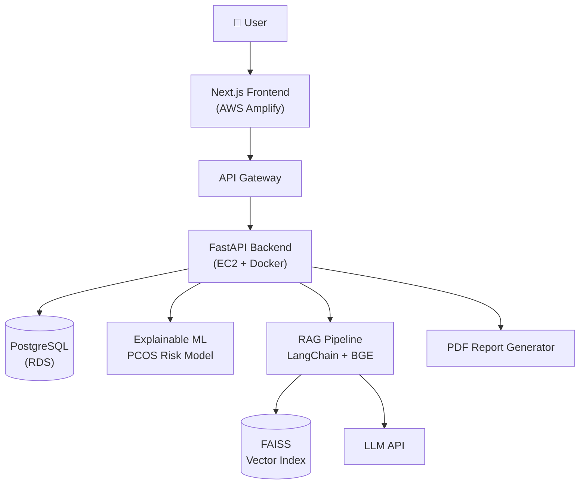

<picture>
  <source media="(prefers-color-scheme: light)" srcset="assets/hero-light.svg"/>
  
</picture>

 

  

  

 

## ⚡ What I Do

<table>
<tr>
<td width="33%" valign="top" align="center">

### 🧠 AI Engineering
Hybrid retrieval (**FAISS + pgvector + BM25 + reranking**), RAG pipelines, explainable ML and **multi-agent systems** with LangGraph.

</td>
<td width="33%" valign="top" align="center">

### 🌐 Full Stack
End-to-end products: **FastAPI** backends, **Next.js / React** frontends, PostgreSQL, Docker, shipped on **AWS**.

</td>
<td width="33%" valign="top" align="center">

### 🏗️ System Design
Learning to make AI apps **scale**: caching, queues, sharding and distributed design. Progress is tracked below.

</td>
</tr>
</table>

---

## 🧰 Tech Stack

  

---

## 🚀 Featured Projects

<table>
<tr>
<td width="50%" align="center">

Explainable-AI PCOS risk prediction + multi-domain RAG (LangChain, FAISS, BGE embeddings) with downloadable PDF reports. Deployed on AWS Amplify, EC2, RDS and API Gateway.
  

</td>
<td width="50%" align="center">

LangGraph agents for resume intelligence, JD analysis, candidate ranking, interview evaluation and recruiter assistance, backed by PostgreSQL + pgvector.
  

</td>
</tr>
<tr>
<td width="50%" align="center">
 

Extracts data from bank statements and payment screenshots with Gemini Vision, plus Groq-powered coaching, budgets and dashboards.
  

</td>
<td width="50%" align="center">
 

Multi-language online editor with live preview, auto-save and a Groq assistant inside Monaco that explains, debugs and inserts code.
  

</td>
</tr>
</table>

<b>🏆 Hackathon builds</b>

 

| Hackathon | Project | Links |
|:--|:--|:--|
| HackerRank Orchestrate | Agentic AI multimodal **Insurance Claim Validator** | [GitHub](https://github.com/anu89ranjan89/hackerrank-orchestrate-2026) · [Live Demo](https://hackerrank-orchestrate-2026-4a7ixwttahgyn3i3hvfhtz.streamlit.app/) |
| RedRob Hackathon | **AI Job Matchmaker & Talent Intelligence Platform** (Data Lead) | [GitHub](https://github.com/anu89ranjan89/redrob-hackathon-2026) |

---

## 🏗️ System Design Learning Journey

 

<b>🔍 Architecture I've already built: SheSync AI on AWS</b>

 

**Next, at scale:** add a cache layer, move PDF generation to async workers, put a load balancer in front of the backend, and add monitoring.

---

## 📊 GitHub Analytics

---

## 🏅 Highlights

<table>
<tr>
<td align="center" width="25%"><h3>🥇</h3><b>Goldman Sachs</b> India Hackathon 2026 Selected participant</td>
<td align="center" width="25%"><h3>🎓</h3><b>PanScience</b> Innovations Fellow</td>
<td align="center" width="25%"><h3>🌍</h3><b>GSoC 2026</b> Wikimedia Foundation 3 proposals submitted</td>
<td align="center" width="25%"><h3>💻</h3><b>200+ DSA</b> 1000+ CodeChef rating CodeChef · LeetCode · GfG</td>
</tr>
</table>

🤝 **Training & Placement Coordinator**, IET Lucknow &nbsp;·&nbsp; 🎓 **MCA**, CGPA 8.57

 

## 🐍 Contribution Snake

<picture>
  <source media="(prefers-color-scheme: dark)" srcset="https://raw.githubusercontent.com/anu89ranjan89/anu89ranjan89/output/github-snake-dark.svg"/>
  <source media="(prefers-color-scheme: light)" srcset="https://raw.githubusercontent.com/anu89ranjan89/anu89ranjan89/output/github-snake.svg"/>
  
</picture>

  

### 📫 Let's build something together

