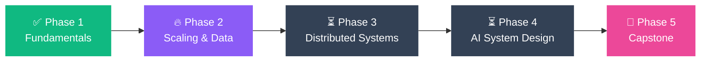
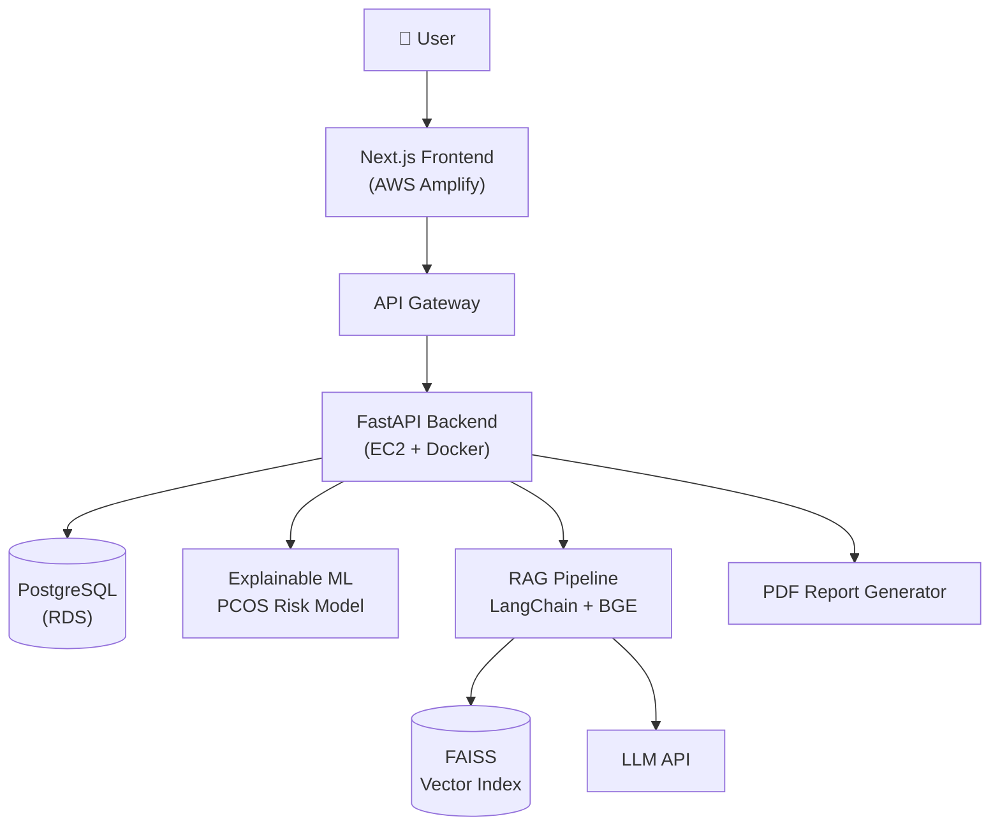

<div align="center">


<a href="https://git.io/typing-svg">
  
</a>

<br/>

[](https://www.linkedin.com/in/anupriya-ranjan-956580384/)
[](mailto:anu89ranjan89@gmail.com)
[](https://anu-portfolio-ashen.vercel.app/)

</div>

---

## 👩‍💻 About Me

```python
class Anupriya:
    role      = "MCA @ IET Lucknow | AI/ML Developer"
    building  = ["RecruitGPT (agentic hiring OS)", "SheSync AI", "MoneyMind AI"]
    stack     = ["Python", "FastAPI", "Next.js", "LangGraph", "PostgreSQL + pgvector"]
    learning  = "System Design → scalable, production-ready AI apps"
    off_duty  = "Training & Placement Coordinator, DSA grinder (200+ solved)"

    def mission(self):
        return "Turn ambiguous real-world problems into deployed software."
```

- 🧠 I build **LLM-powered apps**: hybrid retrieval (FAISS + pgvector + BM25 + reranking), RAG, and multi-agent workflows
- 🌐 I ship **full-stack products** end-to-end, from FastAPI backends to Next.js / React frontends, deployed on AWS
- 🏗️ I'm currently deep in **System Design** (see the roadmap below)
- 🏆 Goldman Sachs India Hackathon 2026 participant · PanScience Innovations Fellow · GSoC 2026 applicant (Wikimedia)

---

## 🛠️ Tech Arsenal

<div align="center">

| | |
|---|---|
| **Languages** |     |
| **GenAI & Agents** |      |
| **Retrieval** |     |
| **Backend** |     |
| **Frontend** |    |
| **Cloud** |  |
| **ML & Data** |    |

</div>

---

## 🚀 Featured Projects

<table>
<tr>
<td width="50%" valign="top">

### 🩺 SheSync AI
*AI-powered women's reproductive health platform*

Explainable-AI PCOS risk prediction + multi-domain RAG (LangChain, FAISS, BGE embeddings) with downloadable PDF reports. Deployed on AWS.

`FastAPI` `Next.js` `PostgreSQL` `RAG` `Docker` `AWS`

[GitHub](https://github.com/anu89ranjan89/SheSync-AI) · [Live Demo](https://main.d11i2xaejtpqa8.amplifyapp.com/)

</td>
<td width="50%" valign="top">

### 🤖 RecruitGPT *(in progress)*
*Autonomous AI hiring operating system*

LangGraph agents for resume intelligence, JD analysis, candidate ranking, interview evaluation and recruiter assistance, backed by pgvector.

`LangGraph` `FastAPI` `Next.js` `pgvector` `Docker`

🔒 *Team project, repo coming soon*

</td>
</tr>
<tr>
<td width="50%" valign="top">

### 💵 MoneyMind AI
*AI personal finance assistant (PanScience Fellowship)*

Gemini Vision extracts data from bank statements and payment screenshots; Groq-powered coaching, budgets and dashboards.

`React` `FastAPI` `PostgreSQL` `Gemini Vision` `Groq`

[GitHub](https://github.com/anu89ranjan89/MoneyMind-AI) · [Demo](https://www.linkedin.com/feed/update/urn:li:activity:7471559147637997568/)

</td>
<td width="50%" valign="top">

### 🎨 CodeCanvas AI
*Online code editor with an AI coding assistant*

Multi-language execution, live preview, auto-save, and a Groq assistant inside Monaco Editor that explains, debugs and inserts code.

`React` `Monaco` `Groq` `REST APIs`

[GitHub](https://github.com/anu89ranjan89/CodeCanvas) · [Demo](https://www.linkedin.com/feed/update/urn:li:activity:7461518346258399232/)

</td>
</tr>
</table>

<details>
<summary><b>➕ More projects & hackathons</b></summary>

<br/>

- 🛡️ **Agentic Multimodal Insurance Claim Validator**: HackerRank Orchestrate Hackathon · [GitHub](https://github.com/anu89ranjan89/hackerrank-orchestrate-2026) · [Live Demo](https://hackerrank-orchestrate-2026-4a7ixwttahgyn3i3hvfhtz.streamlit.app/)
- 💼 **AI Job Matchmaker & Talent Intelligence Platform**: RedRob Hackathon (Data Lead) · [GitHub](https://github.com/anu89ranjan89/redrob-hackathon-2026)
- 📧 **Spam Email Classifier**: NLP + ML pipeline
- ✉️ **Email Generator**: LLM-powered writing assistant
- ⏰ **Momentum**

</details>

---

## 🏗️ System Design Learning Journey

> *"Anyone can make it work. Engineers make it scale."* I'm learning to design the systems behind my AI apps, not just build them.

**📍 Current phase: Phase 2: Scaling & Data Layer**



| Phase | Topics | Status |
|:--|:--|:--:|
| **1. Fundamentals** | Client-server model, HTTP/REST, APIs, DNS, SQL vs NoSQL, latency vs throughput | ✅ Done |
| **2. Scaling & Data Layer** | Load balancing, caching (Redis), DB indexing, replication, sharding, CDN | 🔥 In progress |
| **3. Distributed Systems** | Message queues, async workers, CAP theorem, consistency models, rate limiting, API gateways | ⏳ Up next |
| **4. AI System Design** | RAG at scale, vector DB sharding, embedding pipelines, LLM caching, agent orchestration, observability | ⏳ Planned |
| **5. Capstone** | Re-architect RecruitGPT for scale + write a design doc | 🎯 Goal |

<details>
<summary><b>🔍 Architecture I've already built: SheSync AI on AWS</b></summary>

<br/>



**Next up: what I'd improve at scale** → add a cache layer, move report generation to async workers, put a load balancer in front of the backend, and add monitoring.

</details>


---

## 🎯 Current Focus

| 🔭 Building | 🌱 Learning | 🎯 Goal |
|:--:|:--:|:--:|
| RecruitGPT (agentic AI) | System design & distributed systems | Production-ready AI apps at scale |

---

## 📊 GitHub Stats

<div align="center">


</div>

---

## 🏆 Highlights

- 🥇 Selected for **Goldman Sachs India Hackathon 2026 (CS Edition)**
- 🎓 **PanScience Innovations Fellow**
- 🌍 Submitted **3 proposals** to Wikimedia Foundation (GSoC 2026)
- 💻 **200+ DSA problems** solved · 1000+ CodeChef rating
- 🤝 **Training & Placement Coordinator**, IET Lucknow

---

<div align="center">

### 📫 Let's build something together

[](https://www.linkedin.com/in/anupriya-ranjan-956580384/)
[](mailto:anu89ranjan89@gmail.com)

*⭐ If something here helped you, drop a star!*


</div>
